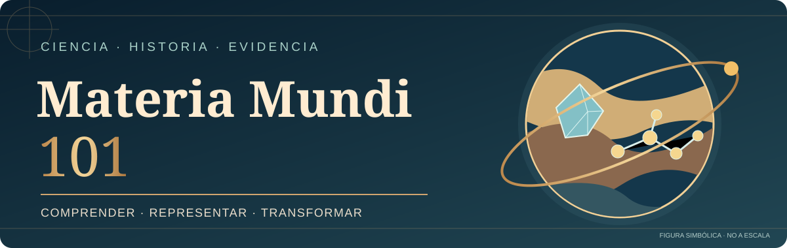
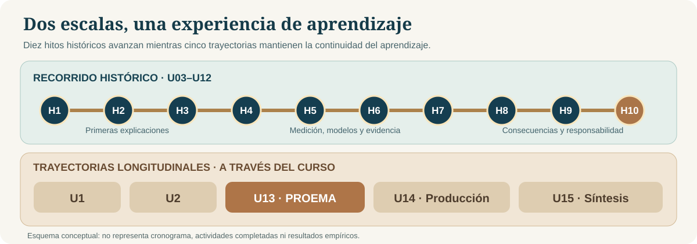

# 🌎 Materia Mundi 101
## Una travesía histórica para comprender cómo conocemos y transformamos la materia



**CIFI 3065 · Educación General · Ciencia, historia, evidencia y responsabilidad**

*Preguntar · observar · representar · contrastar · transformar · decidir*

> Comprender la materia no ha sido únicamente descubrir de qué está hecho el mundo. También ha exigido inventar instrumentos, revisar explicaciones, negociar incertidumbres y preguntarnos qué hacemos con el conocimiento que construimos.

Bienvenidas y bienvenidos a **Materia Mundi 101**, un proyecto de virtualización y diseño curricular de **CIFI 3065** que convierte la historia del conocimiento sobre la materia en una experiencia educativa activa, lúdica, transdisciplinaria y orientada por evidencia.

Este repositorio documenta tanto el **curso en construcción y montaje progresivo** como el **laboratorio metodológico** que lo hace posible. No es solamente un depósito de materiales didácticos, ni un curso declarado empíricamente validado. Es una implementación situada, versionada y sujeta a revisión humana.

## 🚪 Elige tu puerta de entrada

- 🎓 **Estudiantes y personas curiosas:** comienza por [la travesía H1–H10](#-diez-hitos-una-historia-en-movimiento) y descubre qué preguntas organizan el aprendizaje.
- 🧑‍🏫 **Docentes y diseñadores curriculares:** consulta [la arquitectura pedagógica](#-cómo-se-aprende-en-materia-mundi) y el [sistema de calidad](#-producir-revisar-y-aprender-del-proceso).
- 🔬 **Investigadores en educación:** revisa [los alcances de la evidencia](#-estado-del-proyecto-corte-documental) y las fronteras entre diseño, montaje y validación empírica.
- 🧰 **Colaboradores técnicos:** explora [la organización del repositorio](#-cómo-explorar-el-repositorio) y la [arquitectura de tres carriles](#-tres-carriles-una-gobernanza).
- 🧭 **Quienes desean conocer el marco más amplio:** visita el [Framework Proyecto Genérico IA 1](https://github.com/ricardojuanmorales/framework-proyecto-generico-ia-1), proyecto relacionado con identidad y gobernanza propias.

**Acceso a un recurso piloto:** [Aplicación interactiva H6](https://ricardojuanmorales.github.io/materia-mundi-101/h6/). Su publicación técnica no sustituye la evaluación situada de accesibilidad ni de integración Moodle–aplicación–evidencia.

## 🌱 ¿Qué es Materia Mundi?

Materia Mundi parte de una pregunta sencilla de formular, pero difícil de agotar: **¿cómo llegó la humanidad a conocer la materia y qué responsabilidades surgieron al aprender a transformarla?**

En lugar de presentar la ciencia como una sucesión de respuestas definitivas, el curso reconstruye problemas, controversias, representaciones, experimentos e instrumentos que hicieron posibles nuevas explicaciones. La historia ofrece el escenario; la evidencia y los modelos permiten pensar; la reflexión transdisciplinaria ayuda a conectar ese conocimiento con decisiones contemporáneas.

El proyecto articula cuatro propósitos:

1. **Formación científica general:** razonar a partir de pruebas, modelos e incertidumbre sin exigir que el estudiantado se convierta en especialista.
2. **Comprensión histórica y epistemológica:** reconocer que las explicaciones científicas cambian y que toda representación tiene posibilidades y límites.
3. **Aprendizaje activo y lúdico:** utilizar narrativas, recursos visuales, ejercicios, laboratorios e interacciones que tengan una función cognitiva, no meramente decorativa.
4. **Investigación y mejora del diseño educativo:** conservar decisiones, criterios, revisiones y evidencias con responsabilidad docente.

La aspiración es que la ciencia se experimente como una forma humana, revisable y colectiva de investigar el mundo.

## 🗺️ Diez hitos, una historia en movimiento

La trayectoria histórica comprende **diez hitos (H1–H10)**, correspondientes a **U03–U12**. Cada uno pregunta qué cambió en la manera de explicar, medir, representar o intervenir la materia.

| Hito | Movimiento conceptual de la trayectoria |
|---|---|
| **H1 · U03** | Comenzar a explicar la materia y reconocer la diversidad de explicaciones. |
| **H2 · U04** | Examinar transformaciones materiales y las condiciones para explicarlas. |
| **H3 · U05** | Observar, medir y producir comparaciones defendibles. |
| **H4 · U06** | Cuantificar relaciones y analizar sistemas mediante evidencia. |
| **H5 · U07** | Reconocer patrones en los datos y poner a prueba modelos de la materia. |
| **H6 · U08** | Construir lenguajes compartidos de representación y clasificación, incluida la periodicidad. |
| **H7 · U09** | Explorar conectividad, estructura, isomería y límites de los modelos. |
| **H8 · U10** | Investigar qué evidencia puede revelar la estructura interna del átomo. |
| **H9 · U11** | Inferir electrón y núcleo mediante señales instrumentales y revisar modelos atómicos. |
| **H10 · U12** | Evaluar síntesis, materiales, industria, ambiente y responsabilidad ante las consecuencias de transformar la materia. |

Esta tabla es un **mapa de orientación**, no una sustitución de los microdiseños, las FEHE o los guiones canónicos de cada unidad.

**Movimiento transversal:**

```text
preguntar → observar → medir → cuantificar → modelar
→ representar → contrastar → instrumentar
→ reconocer límites → evaluar consecuencias
```

H10 ofrece una síntesis especialmente importante: la capacidad técnica para transformar la materia debe examinarse junto a la evidencia, la incertidumbre y la distribución de beneficios y riesgos.

### Dos escalas de aprendizaje



Los hitos históricos proporcionan una secuencia de problemas científicos. Las trayectorias longitudinales conectan preguntas, evidencias, investigación y reflexión a lo largo del curso. La figura explica la arquitectura pedagógica, no el estado de finalización de cada componente.

## 🧠 Cómo se aprende en Materia Mundi

Cada hito pertenece a una familia histórica común, sin convertirse en una copia idéntica de los anteriores:

```text
Bienvenida y orientación
  → FEHE: problema histórico-epistemológico
  → actividad central de indagación
  → interacción analítica
  → laboratorio y recuperación/reflexión
  → cierre y puente hacia el siguiente hito
```

La **FEHE** articula el problema histórico y epistemológico de la unidad. Las actividades y los laboratorios exigen poner a trabajar ideas y evidencias; los foros invitan al intercambio fundamentado; las recuperaciones y cierres permiten revisar qué se aprendió, qué permanece abierto y cómo se conecta con otros momentos del curso.

**Simetría funcional y navegacional no significa repetición literal.** Cada hito conserva identidad científica e histórica, pero el estudiante encuentra una orientación consistente.

Los recursos pueden incluir narrativas ilustradas de inspiración histórica, cómics, materiales interactivos, representaciones comparadas, análisis de fuentes y experiencias de laboratorio. Su inclusión depende de pertinencia, accesibilidad, procedencia de fuentes y carga cognitiva. Una reconstrucción didáctica no se presenta como documento histórico auténtico.

### Las cinco trayectorias que permanecen

Más allá de H1–H10, el curso mantiene cinco unidades longitudinales:

| Trayectoria | Función en el recorrido |
|---|---|
| **U1** | Orientación y continuidad del aprendizaje. |
| **U2** | Reflexión epistemológica sobre conocimiento, modelos y evidencia. |
| **U13 · PROEMA** | Articulación metodológica de una investigación longitudinal. |
| **U14** | Producción, comunicación y defensa del trabajo. |
| **U15** | Síntesis, reflexión y cosecha de aprendizajes. |

La secuencia de PROEMA conecta un tema común, un subtema grupal y contribuciones individuales con momentos de elaboración progresiva:

```text
E1 (H1) → E2 (H4) → E3 (H7) → E4 (H10)
→ E5 (U13) → presentación grupal (U14)
→ artículo individual (U15)
```

Esta secuencia expresa la arquitectura prevista. **No implica que todas las entregas estén ya realizadas ni evaluadas con estudiantes.**

## 🎨 Aprender con imaginación, sin perder rigor

La dimensión lúdica no consiste en añadir entretenimiento a contenidos ya terminados. Busca abrir oportunidades para formular hipótesis, comparar representaciones, advertir tensiones y hacer visible la evolución de las explicaciones científicas.

El diseño procura distinguir tres niveles de participación: **núcleo**, **profundización** y **exploración**, de modo que los recursos opcionales no se transformen silenciosamente en nuevas obligaciones. Las decisiones de tiempo, accesibilidad y equivalencia de recursos forman parte del microdiseño y de su revisión.

La mediación humana sigue siendo central: una imagen convincente no prueba un hecho, una simulación no es un experimento histórico y una respuesta generada por IA no adquiere por sí misma autoridad científica o curricular.

## 🧬 Tres carriles, una gobernanza

La arquitectura operativa se organiza en **A ↔ B ↔ C**:

| Carril | Responsabilidad |
|---|---|
| **A · Gobernanza** | Canon, decisiones docentes, gates, absorciones, Estado Maestro y trazabilidad. |
| **B · Realización histórica** | Diseño, producción, montaje y verificación situada de H1–H10. |
| **C · Integración longitudinal** | Articulación de U1, U2, U13, U14 y U15, incluida PROEMA. |

**Regla de gobierno:** B y C no se gobiernan entre sí; ambos operan bajo A. Lo aprendido en una realización puede proponerse como mejora metodológica, pero **no entra automáticamente en el canon**.

```text
Decisión y baseline (A)
     ↓             ↓
Hitos históricos (B)    Trayectorias longitudinales (C)
     ↓             ↓
     evidencia situada y aprendizajes
                 ↓
       retorno candidato a A
                 ↓
        revisión humana y versión
```

## 🔍 Producir, revisar y aprender del proceso

El proyecto distingue estados que no deben confundirse:

```text
PROPUESTO → AUTORIZADO → PRODUCIDO → MONTADO
→ VERIFICADO-SITUADO → RETORNO DOCUMENTAL
→ (si procede) VALIDACIÓN EMPÍRICA
```

Son distinciones de responsabilidad, **no una promesa de avance automático ni una única secuencia universal**. Un gate autoriza solo su alcance escrito; un recurso publicado puede conservar problemas técnicos; una revisión del docente no sustituye evidencia de aprendizaje del estudiantado.

Los mecanismos incluyen gates de decisión, control de versiones, inventarios, revisión de procedencia, criterios de carga cognitiva, equivalencias de acceso, QA situada y registros de pendientes. Cuando una actividad se realiza en Moodle, el montaje y la revisión necesitan evidencia concreta de esa plataforma.

## 📍 Estado actual del proyecto

**Noviembre de 2026 · Desarrollo y montaje curricular**

Materia Mundi 101 se encuentra en una etapa avanzada de desarrollo curricular y montaje progresivo de experiencias educativas para la enseñanza virtual de las ciencias desde una perspectiva histórica, activa y transdisciplinaria.

### ¿Qué hemos logrado?

- Diseñar una trayectoria de **diez hitos históricos**, conectando ciencia, evidencia, modelos y transformación de la materia.
- Desarrollar y montar progresivamente actividades, laboratorios, recursos visuales e interacciones educativas.
- Integrar la reflexión científica con **PROEMA**, una investigación que acompaña el curso.
- Establecer mecanismos de revisión docente, accesibilidad, seguimiento del aprendizaje y mejora continua.

### ¿Dónde estamos?

Las experiencias **H1–H9** han avanzado en su desarrollo y montaje, aunque algunas conservan revisiones documentales y técnicas pendientes. **H10**, dedicado a las posibilidades y consecuencias de transformar la materia, cuenta con autorización para su planificación inicial y revisión docente, **no para producción extensa ni montaje en Moodle**.

### ¿Qué sigue?

Concluir revisiones pendientes, definir y desarrollar H10 cuando exista autorización docente, fortalecer la integración de las trayectorias del curso y preparar una futura evaluación con estudiantes para estudiar funcionamiento, accesibilidad y contribución al aprendizaje.

**Alcance de la evidencia:** los avances curriculares y metodológicos están documentados, pero **la validación empírica con estudiantes sigue pendiente**. La planificación, el montaje y la revisión docente no demuestran por sí solos efectividad educativa.

<details>
<summary>Referencia documental para seguimiento y auditoría</summary>

La síntesis pública se basa en el [Estado Maestro v28.0](00_CONTROL_MAESTRO/ESTADO_MAESTRO_CIFI3065_v28.0.md) (4 de noviembre de 2026). Allí se conservan las reservas de reconciliación H7, los pendientes documentales H8/H9 y el [Gate de H10](08_CURSOS_PROGRAMAS_Y_TRAYECTORIAS/CIFI3065/POST_F8/U12-H10/CIFI3065_POSTF8_U12-H10_GATE_A-B_GO_CONTROLADO_v1.0_APROBADO.md), que autoriza únicamente Paso 1. F9 empírica no está activada.

</details>

## 📂 Cómo explorar el repositorio

GitHub **`main`** es la fuente documental versionada de referencia. El proyecto utiliza una estructura de cartapacios **00–21 + 99** y activa las rutas según necesidad real, sin llenar carpetas por formalidad.

| Puerta documental | Para qué sirve |
|---|---|
| [`00_CONTROL_MAESTRO/`](00_CONTROL_MAESTRO/) | Estado, manifiestos, decisiones y ruta maestra. |
| [`03_METODOLOGIA_Y_FLUJO_DE_TRABAJO/`](03_METODOLOGIA_Y_FLUJO_DE_TRABAJO/) | Protocolos de trabajo y arquitectura de carriles. |
| [`07_PLANTILLAS_Y_MODELOS/`](07_PLANTILLAS_Y_MODELOS/) | Instrumentos y modelos de apoyo. |
| [`08_CURSOS_PROGRAMAS_Y_TRAYECTORIAS/CIFI3065/`](08_CURSOS_PROGRAMAS_Y_TRAYECTORIAS/CIFI3065/) | Trayectorias, fases y realizaciones históricas. |
| [`15_EVALUACION_CALIDAD_Y_AUDITORIA/`](15_EVALUACION_CALIDAD_Y_AUDITORIA/) | Calidad, contrastes y auditoría. |
| [`18_DOCUMENTACION_ACTIVA/`](18_DOCUMENTACION_ACTIVA/) | Informes, continuidad y decisiones en curso. |
| [`20_MANTENIMIENTO_Y_EVOLUCION/`](20_MANTENIMIENTO_Y_EVOLUCION/) | Deudas, mejoras y evolución. |
| [`99_ARCHIVO_HISTORICO/`](99_ARCHIVO_HISTORICO/) | Genealogía y antecedentes conservados. |

### Documentos para recuperar el estado

1. [Estado Maestro v28.0](00_CONTROL_MAESTRO/ESTADO_MAESTRO_CIFI3065_v28.0.md).
2. [Arquitectura operativa A–B–C aprobada](03_METODOLOGIA_Y_FLUJO_DE_TRABAJO/CIFI3065_ARQUITECTURA_OPERATIVA_TRES_CARRILES_A-B-C_v1.0_APROBADA.md).
3. [Gate H10 aprobado](08_CURSOS_PROGRAMAS_Y_TRAYECTORIAS/CIFI3065/POST_F8/U12-H10/CIFI3065_POSTF8_U12-H10_GATE_A-B_GO_CONTROLADO_v1.0_APROBADO.md).
4. [Kit de activación H10](08_CURSOS_PROGRAMAS_Y_TRAYECTORIAS/CIFI3065/POST_F8/U12-H10/CIFI3065_POSTF8_U12-H10_KIT_ACTIVACION_CARRIL_B_v1.0.md).
5. [Repositorio del Framework relacionado](https://github.com/ricardojuanmorales/framework-proyecto-generico-ia-1).

Los nombres de archivo y sus versiones forman parte de la trazabilidad. Si una referencia deja de ser vigente, debe documentarse su sucesora en lugar de reescribir silenciosamente la historia.

## 🤖 Humano, tecnología e inteligencia artificial

La IA puede apoyar análisis, propuestas, adaptación de recursos y producción documental o visual. No sustituye la decisión pedagógica ni la verificación de fuentes, derechos, accesibilidad o aprendizaje. El docente conserva autoridad sobre gates, objetivos, carga, criterios y aprobación de la publicación.

La relación con el Framework es de **implementación situada y posible retorno metodológico**, no de equivalencia total entre sus respectivos alcances, estados o niveles de validación.

## 🔭 Horizonte abierto

Materia Mundi tiene todavía trabajo por realizar: reconciliar retornos, atender pendientes técnicos y documentales, cerrar decisiones de H10, fortalecer integraciones longitudinales y, cuando proceda, comenzar una fase de investigación empírica con evidencia auténtica del estudiantado.

El valor del proyecto no reside en aparentar que todo está terminado. Reside en hacer visible **qué se sabe, cómo se produjo, qué se revisó, qué falta y quién debe decidir el siguiente paso**.

> La historia de la materia continúa. También continúa la historia de cómo aprendemos a enseñarla.

---

**Estado de este documento:** `README v2.1 · INTEGRACIÓN VISUAL Y SÍNTESIS DOCENTE · PUBLICADO EN main`  
**Fecha de elaboración y aprobación:** 17 de noviembre de 2026  
**Referencia documental principal:** Estado Maestro CIFI 3065 v28.0 (2026-11-04) y Gate U12/H10 v1.0 aprobado.